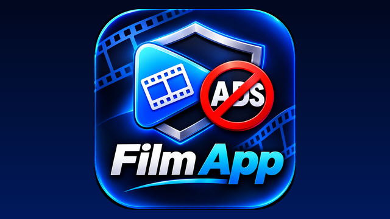

# AdBlock Film

Bloqueador de anuncios por DNS que solo actúa sobre las apps que marques en la pantalla principal
(usa `addAllowedApplication`: ninguna otra app pasa por el túnel). Pensado para Google TV / Android TV y celular.

| App | Paquete | Anuncios que usa |
|---|---|---|
| Film App | `com.digitalproshare.filmapp` | ironSource/LevelPlay, Unity, Pangle, Mintegral, AppLovin... |
| miRadio (Colombia) | `moldesbrothers.miradioco` | Google AdMob / IMA |

En la pantalla principal cada app tiene su casilla (sección **Radio FM** para las dos de radio) y un
botón *Abrir*. Cada una tiene además un icono «(sin anuncios)» para el modo lanzador; por defecto solo aparece el de Film App (así quedan 2 iconos en total), y los de radio se muestran u ocultan con las casillas de «Iconos de acceso directo». Los dominios
de anuncios son comunes a todas las apps marcadas; si algo se rompe, desmarca la red de anuncios que
corresponda (por ejemplo "Extras para apps de radio").

Lo que NO se bloquea a propósito: `adapty.io`,
`fundingchoicesmessages.google.com` (formulario de consentimiento de Google) y las analíticas de Firebase.
Si una app de radio se queda cargando al abrir, prueba a desmarcar "AppLovin" o "Extras".

Aviso: las apps de radio reproducen en segundo plano. Al salir de una, la VPN se apaga y el sistema
puede reiniciar sus conexiones, así que el audio podría cortarse un momento. Si te pasa, avísame.

## Compilar con GitHub Actions
1. Crea un repositorio **público** y sube todo el contenido (incluida la carpeta `.github`).
2. Pestaña **Actions** > *Build APK*. Al terminar se publica el APK en **Releases**.
3. Enlace directo: `https://github.com/USUARIO/REPO/releases/latest/download/AdBlockFilm.apk`

## Instalar en Google TV
- Con la app **Downloader**: escribe el enlace directo anterior y permite "Instalar apps desconocidas" para Downloader.
- O con adb: `adb connect IP_DE_LA_TV` y `adb install AdBlockFilm.apk`.

## Inicio automático con Film App (celular Samsung y Google TV / Android TV)
La app vigila qué app está en pantalla con el permiso **Acceso de uso** (no usa accesibilidad).
La VPN se enciende sola al abrir Film App y se apaga ~2 s después de que otra app, el launcher o la
pantalla apagada ocupen su lugar. Con Film App cerrada no hay ninguna VPN activa, así que las apps que
detectan VPN funcionan normal. Se muestra una notificación mínima "AdBlock Film" mientras vigila.

Configuración, una sola vez:
1. Instala el APK. Si Play Protect avisa, toca *Más detalles* > *Instalar de todos modos*, o apaga
   Play Protect un momento (Play Store > perfil > Play Protect > Ajustes).
2. Abre **AdBlock Film**, pulsa *Activar bloqueo* y acepta el permiso de VPN (solo la primera vez).
3. Pulsa *Activar inicio automático con Film App* y activa **Acceso de uso** para AdBlock Film.
   - **Celular:** se abre la pantalla de Acceso de uso; activa el interruptor y vuelve.
   - **Google TV sin esa pantalla:** por adb:
     `adb shell appops set com.adblockfilm GET_USAGE_STATS allow`
4. Celular Samsung: Ajustes > Aplicaciones > AdBlock Film > Batería > *Sin restricciones*.

Tras reiniciar el aparato el vigilante vuelve solo.

### Modo lanzador (si no puedes dar "Acceso de uso")
Android 14 bloquea ese permiso en apps instaladas fuera de la tienda. Sin él, usa el icono
**Film App (sin anuncios)** en lugar del de Film App: enciende la VPN y abre Film App. Solo pide el
"Aceptar" de la VPN la primera vez. Como no puede ver cuándo cierras Film App, la VPN se apaga sola
cuando se apaga la pantalla o tras 10 minutos sin consultas DNS de Film App (o con *Desactivar bloqueo*).
En una película larga, si pasan más de 10 minutos sin consultas, se apagará antes de terminar: vuelve a
abrir Film App con el icono para encenderla.

## Uso manual
1. Abre **AdBlock Film**, pulsa *Activar bloqueo* y acepta el permiso de VPN.
2. Pulsa *Abrir Film App* (o ábrela desde el launcher).
3. Si pasa algún anuncio, mira "Permitidos recientes" y añade ese dominio.

## Si la app se queda esperando el anuncio
- Deja **sin marcar** "LevelPlay: control del SDK".
- Prueba con todas las casillas desmarcadas: si así tampoco abre, la app detecta la VPN.
- Si abre, ve marcando redes una a una hasta encontrar la que la deja colgada.

## DNS de AdGuard (solo para Film App)
La casilla "Usar DNS de AdGuard como filtro extra" reenvía las consultas de Film App al DNS público
de AdGuard (94.140.14.14 / 94.140.15.15), que bloquea anuncios y rastreadores. Afecta solo a Film App,
no hace falta tocar el DNS privado del sistema. Si falla, usa Cloudflare (1.1.1.1).

## Limitaciones
- Ajustes > Red > DNS privado: Desactivado o Automático.
- No funciona si hay otra VPN activa.
- Si activas el bloqueo a mano y luego abres otra app, también se apaga.
- Si desinstalas AdBlock Film, repite los pasos 2 y 3.

## Cómo funciona el modo automático
- Con «Acceso de uso» concedido, AdBlock Film vigila qué app está en pantalla. Enciende la VPN al abrir una app marcada
  y la apaga ~2 s después de que abras otra cosa. Así el resto de apps no ven nunca una VPN activa.
- Apps de radio (miRadio): la VPN se mantiene mientras suena en segundo plano (inicio o pantalla apagada)
  y se apaga cuando abres cualquier otra app.
- Mientras la VPN está activa aparece un aviso «Bloqueo de anuncios activo» con el botón **Desactivar**.
  Si lo pulsas con la app abierta, no se reenciende hasta que salgas de ella y vuelvas a entrar.
- El icono «Film App (sin anuncios)» viene oculto: solo sirve si el inicio automático no funciona en tu equipo.
  Se puede mostrar desde la pantalla principal.

## Apps de radio: qué anuncios usan (análisis de los APK)
- miRadio: Google AdMob (con IMA y formulario de consentimiento).
Todos esos dominios están en las listas. Si aun así ves anuncios al abrirlas, usa los iconos
«(sin anuncios)» de cada radio (se marcan en «Iconos extra»): esos encienden la VPN **antes** de abrir la app,
mientras que el modo automático la enciende justo después de que se abre.

## Análisis en profundidad de miRadio
- miRadio es **una app con 14 versiones por país** (miradio, ...co, ...pe, ...mx, ...ec, ...arg, ...cl, ...br, ...pt, ...de, ...it, ...irl, ...uk, ...ve).
  Antes solo se protegía la de Colombia; ahora se protegen todas las que estén instaladas.
- miRadio solo usa Google AdMob. Radio Box usa AppLovin MAX + Pangle + Amazon APS + AdMob.
  Todos los dominios de anuncios hallados en ambos APK están cubiertos por las listas.
- Ninguna de las dos apps usa DNS propio ni DoH, así que el filtrado por DNS sí les aplica,
  siempre que la VPN esté activa **antes** de que pidan sus anuncios.
- Las radios mantienen la VPN mientras su servicio de reproducción siga activo (aunque abras otras apps)
  y la apagan al detener la radio. En el panel, la línea «La VPN cubre» muestra qué apps están dentro.

## Diagnóstico de anuncios que siguen saliendo
- Cada línea del panel ahora muestra **hora, dominio y [app]** que hizo la consulta, para saber quién pide los anuncios.
- «Mantener la VPN lista en la pantalla de inicio»: enciende la VPN mientras estás en el inicio (pantalla encendida),
  de modo que las radios ya la tengan activa al abrirse. Se apaga al abrir cualquier otra app.
- «Incluir Google Play Services»: prueba para el caso en que Google pida los anuncios por su cuenta.

## Cambios recientes
- miRadio: ahora solo se protege la versión de **Colombia** (`moldesbrothers.miradioco`).
- Pantalla principal rediseñada: botón de encendido, tarjetas con el icono real de cada app, ajustes con interruptores
  y las opciones técnicas plegadas en «Avanzado».
- Si falta el permiso «Acceso de uso», aparece un aviso naranja arriba con el botón «Activar ahora».

## Pantalla de inicio y aviso
- La imagen de bienvenida solo aparece cuando la app arranca desde cero. Si ya estaba abierta, entrar por el icono
  o tocando el aviso «Bloqueo de anuncios activo» lleva directo al contenido.
- «Incluir Google Play Services» viene activado por defecto: se comprobó que Google pide por su cuenta los anuncios
  de las radios y esa opción los bloquea.

## Permisos explicados
Antes de cada permiso la app muestra una ventana con el motivo (VPN, Acceso de uso, Notificaciones). Al abrir la app
ya no se pide nada por sorpresa. En la pantalla principal, la sección «Permisos y para qué sirven» muestra el estado de
cada uno (Concedido / Falta) y un botón para activarlo.

## YouTube (análisis del APK v21.46.522)
- Paquete `com.google.android.youtube`. Usa Cronet para la red e incluye el SDK de anuncios de Google (AdMob).
- Los anuncios de banner, los de tipo AdMob y los pings de rastreo/clics usan `googleads.g.doubleclick.net`,
  `pagead2.googlesyndication.com`, `adclick.g.doubleclick.net`, `googleadservices.com`, etc. Eso sí se bloquea.
- Los anuncios de **video** (antes, durante y después del video) llegan dentro de la misma respuesta del reproductor
  y se descargan de los mismos servidores que el video (`youtube.com`, `googlevideo.com`). El DNS no puede separarlos
  sin romper YouTube, así que este método no los quita.

## Cambios recientes
- Radio Box se quitó de la lista: ya no se protege ni tiene icono «(sin anuncios)».
- YouTube: además de `com.google.android.youtube` (celular) se protege `com.google.android.youtube.tv`
  (YouTube para Google TV / Android TV).

## Film Plus v1.4.7 (`com.dpsteam.filmplus`, versión para TV box)
- Se protege junto con Film App (misma fila en el panel: «Film App / Film Plus»). El icono «(sin anuncios)» y el botón
  «Abrir» usan la que esté instalada.
- Anuncios: solo **ironSource / LevelPlay** y **Unity Ads** (adaptadores de ironSource y Unity). Interstitial por LevelPlay.
- Dominios nuevos que faltaban y ahora se bloquean: `ssacdn.com`, `ironbeast.io` (ironSource) y `iads.unity3d.com`,
  `unity3dusercontent.com` (Unity). El control de LevelPlay (`mediation.unity3d.com`) se deja pasar a propósito para que
  el SDK avise enseguida de que no hay anuncios y la app continúe.
- No se bloquean: Firebase, TMDB, `raw.githubusercontent.com`, `cdn.jsdelivr.net` y `rawcdn.githack.com` (la app los usa
  para sus listas y actualizaciones).
- Sin DNS propio, sin DoH, sin detección de bloqueadores propia (el aviso `AD_BLOCKER_DETECTED` es del SDK de ironSource).
